# BerthWise

**AI berth allocation & yard optimization for congested ports — built around the Port of Casablanca.**

[](https://nextjs.org/)
[](https://www.typescriptlang.org/)
[](#testing)
[](./LICENSE)

BerthWise turns vessel schedules into an optimized berth plan and a rehandle-minimal yard stacking plan. It was designed against a concrete crisis: the Port of Casablanca — handling ~65% of Morocco's foreign trade — saw throughput collapse from ~2,800 to ~800 containers/day, with vessels and trucks waiting hours at anchorage and gates. The engines in this repo (berth allocation × 5 algorithms + an exact solver, crane scheduling, tide windows, yard stacking + relocation, robust planning under ETA uncertainty, ETA prediction, KPI command) attack exactly that kind of congestion.

> **Live demo:** deploy this repo to Vercel (zero-config Next.js) and open `/demo`.
>
> The demo runs entirely in the browser: 10 vessels inbound on Casablanca, 4 berths, 8 shared cranes, 40 boxes in the yard. Tune congestion, set objective weights, compare five algorithms, grade them against the proven optimum, stress-test the plan against ETA slips, and drag vessels on the Gantt.

---

## The problem

A congested port fails in five linked places:

1. **Vessels queue at anchorage** — berths are assigned first-come-first-served, so a 300 m vessel can block a berth a smaller ship could have used hours earlier.
2. **Record grain imports compete with containers** — bulkers and box ships fight for the same quays and cranes.
3. **Yards bury urgent containers** — boxes are stacked by arrival, not by departure, so every retrieval digs through boxes that aren't leaving yet (rehandles).
4. **No truck appointment system** — gates work FCFS; queues spill onto the port road.
5. **Customs & gates bottleneck** — paperwork stalls cargo long after the vessel has sailed.

BerthWise addresses **1–3** directly (the waterside half of the crisis) and quantifies the gain of fixing them. Causes 4–5 are companion projects: see [`tas-casablanca`](https://github.com/eliem08/tas-casablanca) (truck appointments) and [`gatewatch`](https://github.com/eliem08/gatewatch) (gate OCR).

## What it does

| Engine | Method | Input → Output |
|---|---|---|
| **Berth allocation** | Greedy + simulated annealing + tabu search + genetic algorithm + ALNS (seeded, deterministic) | Vessel schedule → berth × time assignment minimizing a weighted waiting + fuel + crane-cost objective |
| **Exact solver** | Canonical-order branch-and-bound with admissible lower bound | ≤ 8 vessels → proven optimum + per-heuristic optimality gaps |
| **Benchmarks** | Cordeau-style instances (6/12/25 vessels) | Standard-structure test set; exact ground truth where provable |
| **Crane scheduling** | Head-of-sequence list scheduling against a shared pool | Berth plan → per-vessel crane counts + re-timed starts, pool never over-allocated |
| **Tide windows** | Semidiurnal high-water model (12.42h period) | Deep-draft vessels (≥12m) may only berth inside a tide window |
| **Yard stacking** | Best-fit by departure time + expected-relocation stacking | 40 boxes + retrieval order → stack plan minimizing relocations |
| **Relocation (RSP)** | True relocation simulation (blocks relocation problem) | Stack plan → relocation moves incl. re-relocations + truck delay |
| **Robust planning** | Buffer-based robust counterpart + Monte-Carlo stress test | ETA uncertainty set (±6h) → feasibility rate + price of robustness |
| **ETA prediction** | Constant-velocity sailing + congestion delay | Voyage legs + congestion level → predicted ETAs feeding the planner |
| **KPI command** | Before/after analytics | Greedy vs winner → waiting, utilization, rehandles, throughput |

**Grain-priority mode.** Casablanca's crisis coincides with record grain imports. One toggle re-sequences grain bulkers ahead of container ships on grain-capable berths — the policy lever a harbor master actually has.

**Multi-objective weights.** Three sliders (waiting / fuel / crane cost) set the planner's objective. Weights are normalised to sum to 1; each term is scaled by a fixed reference (40h / 40t / $4,000) so the sliders trade off in comparable units. Re-optimizing on any slider change re-runs all five algorithms.

**Interactive Gantt.** Drag a vessel block to another berth or time. Every drop is revalidated — berth length, grain capability, ETA, overlap, tide window, crane pool — and invalid drops are rejected with a specific reason. Accepted moves rebuild the plan and recompute KPIs live. The plan exports to CSV from the Berth plan tab.

## The problem, stated formally

In the taxonomy of Bierwirth & Meisel (2010) and the classification of Steenken et al. (2004), this is a **discrete, dynamic berth allocation problem with time (tide) windows**, berth-length and cargo compatibility, coupled to quay-crane assignment (shared pool) and yard relocation. The mixed-integer program the heuristics approximate:

```
Sets
  V  vessels i, j        B  berths k        W  tide windows

Parameters
  aᵢ  ETA of vessel i            pᵢ  handling time of vessel i
  Lᵢ  length of vessel i         L̄ₖ  length of berth k
  B(i) ⊆ B  berths feasible for i (length + grain capability)
  draftᵢ, tide windows W (deep-draft vessels: draft ≥ 12 m)

Variables
  xᵢₖ ∈ {0,1}   1 if vessel i is assigned to berth k
  yᵢⱼₖ ∈ {0,1}  1 if vessel j immediately follows vessel i on berth k
  sᵢ ≥ 0        berthing (start) time of vessel i
  wᵢ ≥ 0        waiting time of vessel i

minimise   Σᵢ wᵢ                      (core objective; the app adds
                                      fuel + crane-cost terms, weighted)

subject to
  Σₖ∈B(i) xᵢₖ = 1                  ∀i   every vessel to one feasible berth
  flow conservation on y           ∀i,k each vessel has ≤ 1 predecessor
                                      and ≤ 1 successor per berth
  sᵢ ≥ aᵢ                          ∀i   cannot berth before ETA
  sⱼ ≥ sᵢ + pᵢ − M·(1 − yᵢⱼₖ)       ∀i,j,k  no overlap on a berth (big-M)
  wᵢ = sᵢ − aᵢ                      ∀i   waiting definition
  sᵢ ∈ ∪W  if draftᵢ ≥ 12 m               deep-draft entry only at high water
  xᵢₖ = 0  if Lᵢ > L̄ₖ or (grain i, non-grain k)
```

The MILP is NP-hard (it contains single-machine sequencing with release dates). That is why the app solves it with five metaheuristics for realistic sizes and reserves the exact branch-and-bound for ≤ 8 vessels, where proof is affordable. See the *Research* tab in the demo for the formulation, the exact solver, benchmarks, and references.

## Architecture

```mermaid
flowchart LR
    A["Vessel schedule\n+ voyage legs"] --> B["ETA predictor\n(constant-velocity +\ncongestion delay)"]
    B --> C["Berth optimizer\n(greedy + annealing\n+ tabu + GA + ALNS)"]
    C --> D["Crane scheduler\n(shared 8-crane pool\n+ tide windows)"]
    D --> E["Berth plan\n(draggable Gantt)"]
    B --> F["Yard optimizer\n(best-fit + expected\nrelocation stacking)"]
    F --> G["Stack plan\n(block view)"]
    C --> X["Exact solver\n(branch-and-bound,\n≤ 8 vessels)"]
    X --> H["KPI command\n(before / after)"]
    E --> H
    G --> H
    H --> I["Harbor master\ndecision"]
    style B fill:#0d1c33,stroke:#38bdf8
    style C fill:#0d1c33,stroke:#f5a623
    style D fill:#0d1c33,stroke:#38bdf8
    style F fill:#0d1c33,stroke:#f5a623
    style H fill:#0d1c33,stroke:#38bdf8
    style X fill:#0d1c33,stroke:#34d399
```



The optimizers are **stateless, dependency-free TypeScript** (`src/lib/`). They run in the browser here, but they are designed to be embedded in any terminal operating system: pure functions in, plans out, no I/O.

## The business case

Congestion is priced by the hour. In the built-in demo scenario (10 vessels, 4 berths):

- **Waiting time** — the winning algorithm cuts average anchorage waiting by 58% vs FCFS in the demo scenario (5.7h → 2.4h per vessel, tides and crane pool on). Waiting burns bunker fuel at anchor and triggers demurrage clauses.
- **Rehandles** — departure-aware stacking eliminates unproductive crane moves in the demo yard (24 → 0 vs arrival-order stacking). Every rehandle is a crane cycle spent moving a box twice.
- **Throughput** — higher berth utilization means more vessels served with the same concrete: the cheapest capacity expansion is better scheduling.

Multiply *your* waiting hours by *your* demurrage rate and *your* rehandles by *your* crane-move cost — the demo's before/after deltas are the template for that calculation.

## Project structure

```
berthwise/
├── src/
│   ├── app/
│   │   ├── page.tsx          # Marketing landing page
│   │   ├── demo/page.tsx     # Interactive dashboard (the sales pitch)
│   │   ├── layout.tsx        # Fonts, header, footer
│   │   └── globals.css       # Harbor design system
│   ├── components/
│   │   ├── GanttChart.tsx    # Draggable berth × time visualization + tide bands
│   │   ├── AlgorithmTable.tsx# Five algorithms side-by-side
│   │   ├── ResearchPanel.tsx # Exact solver, benchmarks, MILP, references
│   │   ├── RobustPanel.tsx   # Robustness tradeoff curve
│   │   ├── RelocationPanel.tsx# Blocking vs true-relocation comparison
│   │   ├── CraneChart.tsx    # Crane-pool utilisation over time (recharts)
│   │   ├── YardVisualizer.tsx# Stack/block yard view
│   │   ├── KpiCards.tsx      # Headline metrics
│   │   ├── CompareCharts.tsx # Before/after charts (recharts)
│   │   └── EtaTable.tsx      # Vessel ETA predictions
│   └── lib/
│       ├── berth.ts          # Berth allocation (greedy, annealing, tabu, GA, ALNS, drag)
│       ├── exact.ts          # Branch-and-bound exact solver + gaps
│       ├── benchmarks.ts     # Cordeau-style benchmark instances
│       ├── ga.ts             # Genetic algorithm (OX crossover, elitism)
│       ├── alns.ts           # Adaptive large neighbourhood search
│       ├── relocation.ts     # True relocation simulation + expected-relocation stacking
│       ├── robust.ts         # Buffer-based robust planning + stress test
│       ├── cranes.ts         # Shared-pool crane scheduling
│       ├── tide.ts           # Semidiurnal tide-window model
│       ├── economics.ts      # Fuel proxy, crane cost, weighted objective
│       ├── csv.ts            # Berth-plan CSV export
│       ├── yard.ts           # Yard stacking optimizer (blocking count)
│       ├── eta.ts            # ETA prediction model
│       ├── kpi.ts            # KPI computation & comparison
│       ├── data.ts           # Demo dataset (stylized Casablanca)
│       ├── types.ts          # Domain types
│       ├── rng.ts            # Seeded PRNG (mulberry32)
│       ├── contracts/        # Phase C: versioned zod wire contracts (1.0.0)
│       ├── plan-service.ts   # Phase C: validated plan generation (Result-based)
│       ├── idempotency.ts    # Phase C: DEMO-ONLY in-memory idempotency store
│       ├── audit.ts          # Phase C: append-only audit log (dev-labeled)
│       ├── auth.ts           # Phase C: Role/AuthProvider + DevMockAuthProvider
│       ├── rate-limit.ts     # Phase C: in-memory token-bucket limiter
│       ├── http.ts           # Phase C: body cap, error envelopes, no stack traces
│       └── __tests__/        # vitest suites
├── src/app/api/plans/      # Phase C: demo API (POST /api/plans, POST /api/plans/[id]/approve)
├── public/
└── ...
```

## Phase C — persistence, security, APIs

Phase C hardens the planning core for service use under a "minimum
necessary" doctrine: no database is wired (everything stays local and
in-memory, clearly labeled DEMO-ONLY), no secrets exist in code.

- **Versioned contracts** (`src/contracts/`, all `1.0.0`): `VesselSchedule`
  (vessel call; `etdUtc` must be after `etaUtc`, UTC timestamps enforced),
  `BerthPlan` (one record per vessel assignment; non-empty crane list),
  `ResourceAvailability` (explicit `capacityUnit`; berth records must declare
  `berthLengthM` **and** `maxDraftM` so the draft-vs-depth gate can run),
  `OptimizationRecommendation` (deliberately mirrors the TAS shape — same
  fields, no shared backend, no shared package; sync by convention),
  `AuditEvent`.
- **Validated generation** (`src/lib/plan-service.ts`): `generatePlan(raw)`
  parses the request against the contracts, checks idempotency, runs
  feasibility pre-gates (length / grain / draft-vs-depth per vessel), runs the
  unchanged Phase B greedy + crane-pool planner, then post-validates the
  emitted records (draft vs depth, window inside availability, crane capacity
  over time). Failures return typed `Result` errors (`validation_failed` with
  per-field issues, `infeasible` with reasons) — never silent coercion, never
  an invalid schedule out.
- **Idempotency**: repeated keys return the stored response deep-equal; the
  same key with a different payload is rejected (`idempotency_key_reuse`).
- **Audit trail**: append-only log of `plan.generated` / `plan.approved` /
  `plan.superseded` with before/after plan ids, approver and reason.
- **Auth/RBAC**: `Role = viewer|planner|approver|admin`; approving a plan
  requires `approver`. `DevMockAuthProvider` is demo-only — the real-provider
  contract (signature verification, server-side role mapping, never logging
  tokens) is documented in `src/lib/auth.ts`.
- **API hygiene**: demo routes cap bodies at 1 MiB, rate-limit per client
  (token bucket, 20 req/min), and return structured `{ error, … }` envelopes
  with no stack traces.
- **Honest limitation**: the Phase B planner is depth-unaware, so a scenario
  whose greedy output would put a deep vessel on a shallow berth is *refused*
  rather than emitted — declare only depth-adequate berths.
- **CI**: `npm audit --audit-level=high` gates the workflow (fails on high or
  critical advisories); Dependabot runs weekly for npm.

## Getting started

```bash
npm install
npm run dev        # http://localhost:3000 — landing at /, demo at /demo
npm test           # vitest: 101 tests (incl. the Phase B audit suite)
npm run typecheck  # tsc --noEmit
npm run lint       # eslint (flat config, next/core-web-vitals + next/typescript)
npm run build      # production build
```

CI (`.github/workflows/ci.yml`) runs `npm ci`, typecheck, lint, tests, and
build on pushes to `harden/**` / `main` and on pull requests.

Input validation: every public planner, the crane scheduler, and the yard
stacking functions validate their inputs up front (`src/lib/validate.ts`) —
non-finite numbers, non-positive handling times or lengths, duplicate ids,
and non-permutation retrieval ranks throw a clear `invalid input` error
instead of producing a silently invalid plan. Beam and per-berth depth
limits are not modelled (the `Vessel` type carries LOA and draft only;
draft ≥ 12 m is enforced via tide windows).

Deploy: push to `main` — the Vercel project builds automatically (`next build`).

## How the demo works

1. **Set port congestion** (0–100%). Higher congestion inflates predicted ETAs via the delay model.
2. **Toggle grain priority.** Grain bulkers are sequenced first on grain-capable berths.
3. **Toggle tide windows.** Deep-draft vessels (≥12m) may only berth during high-water windows, shown as cyan bands on the Gantt.
4. **Set objective weights.** Waiting / fuel / crane-cost sliders re-run all five algorithms under the new objective.
5. **Compare five algorithms.** The *Algorithms* tab shows greedy, simulated annealing, tabu search, genetic algorithm, and ALNS side by side with the winner.
6. **Grade against truth.** The *Research* tab runs the exact branch-and-bound solver on a small vessel subset and reports every heuristic's optimality gap, plus Cordeau-style benchmarks.
7. **Stress-test the plan.** The *Robustness* tab builds buffer-based robust plans against ±6h ETA slips and shows the feasibility-vs-cost tradeoff.
8. **Drag vessels on the Gantt.** The *Berth plan* tab lets you drag a block to another berth/time; invalid drops are rejected with a reason. Export the plan as CSV.
9. **Inspect cranes.** The *Cranes* tab charts the shared 8-crane pool over time and lists per-vessel crane assignments.

Every run is **deterministic for a fixed seed** — same inputs, same plan, every time. Change the seed to explore alternative search trajectories. Manual drag edits reset when any control changes (they are a what-if overlay, not a saved plan).

## Algorithms

**Berth allocation** (`src/lib/berth.ts`). The problem is NP-hard (a variant of berth allocation with time windows). Five algorithms race on the same vessel set:

- **Greedy (FCFS)** — vessels in ETA order, each taking the feasible berth with the earliest start (tide-adjusted when enabled).
- **Simulated annealing** — greedy start, then random relocate moves (one vessel to a random position on a random feasible berth) accepted by a cooling temperature schedule. Objective: weighted waiting + fuel + crane cost (normalised), with a small makespan tiebreak.
- **Tabu search** — same neighbourhood, but a short-term memory forbids recent (vessel, berth) moves for 12 iterations unless they beat the global best (aspiration). Each iteration samples 8 candidate moves and applies the best non-tabu one.
- **Genetic algorithm** (`src/lib/ga.ts`) — population of (order, berth) chromosomes: `order` is a permutation of vessels, `berth[i]` the berth of vessel *i*. Decoding sweeps each berth's subsequence of `order`. Order crossover (OX) on the permutation, uniform crossover on the berth vector, swap mutation, random feasible-berth reassignment, elitism (best 2), tournament selection. The greedy plan seeds generation 0, so GA never scores worse than greedy.
- **ALNS** (`src/lib/alns.ts`) — adaptive large neighbourhood search after Ropke & Pisinger (2006). Destroy operators: random removal, worst-cost removal (largest waiting, noise-perturbed), time-window removal (vessels starting in a random 12h window). Repair: regret-2 insertion — every removed vessel is evaluated at every feasible (berth, position), and the vessel with the largest regret (2nd-best − best insertion cost) is inserted first. Operator weights adapt from observed scores (σ₁=33 new global best, σ₂=9 better than current, σ₃=13 accepted; reaction factor 0.1); acceptance is simulated-annealing-style. Starts from greedy and tracks the best, so ALNS never scores worse than greedy.

Feasibility (length fit, grain capability, no overlaps, tide windows) holds by construction on every move. Default budget: 400 ms per SA/tabu search — fast enough for interactive use. GA (40 × 60) and ALNS (400 iterations) use fixed evaluation budgets, not wall clock. All randomness flows through a seeded PRNG, so runs are reproducible.

**Exact solver** (`src/lib/exact.ts`). Canonical-order branch-and-bound: vessels are appended to the end of berth sequences in nondecreasing (start, vessel id) order, which visits each distinct plan exactly once. The lower bound at a node is the placed cost plus, for every unplaced vessel, the cheapest possible additional waiting/fuel/crane cost over its feasible berths (tide-adjusted). The incumbent starts at the greedy plan; the search stops at a 2M-node cap (then `provenOptimal = false`) or when the tree is exhausted. Practical limit: ≤ 8 vessels — the tree is exponential, and the solver refuses larger instances rather than pretending. Gaps are `(heuristic − optimum) / optimum × 100`.

**Benchmarks** (`src/lib/benchmarks.ts`). Three Cordeau-style instances (6 vessels/2 berths, 12/3, 25/5 — the I2 size class) generated with the documented Cordeau et al. (2005) structure: discrete berths, dynamic arrivals, mixed vessel sizes, Gioia-Tauro-style traffic. Honesty note: the original Cordeau instance files sit behind a Google sign-in and per-instance published optima could not be retrieved from any openly accessible source, so these instances reproduce the *structure*, not the original files or values — and ground truth is our exact solver where the instance is small enough to prove. If you hold the original files, the same solver and heuristics run unchanged on them.

**Robust planning** (`src/lib/robust.ts`). Uncertainty set: each realised ETA ∈ [ETA − 6h, ETA + 6h] (box set, no distribution assumed). A robust plan with buffer β is optimised against ETAs inflated by β, then stress-tested on 200 seeded scenarios: a scenario is feasible iff no vessel's realised start slips more than 2h past its published start and the makespan stays within 2h of plan. The tradeoff curve (β = 0…8h) reports nominal objective, cost of robustness, feasibility rate, mean/worst slip. Note β = 8h exceeds the 6h half-width, so its published starts can never slip (the sweep is monotone in ETAs) — it scores 100% by construction, at a nominal cost. This is the price of robustness (Bertsimas & Sim 2004).

**Crane scheduling** (`src/lib/cranes.ts`). After the berth plan is chosen, a head-of-sequence list schedule assigns cranes and re-times starts: container vessels take 1 crane per ~1,200 TEU (capped by the berth), grain vessels take 1, and the port-wide pool is 8 cranes. A vessel starts at the earliest time its ETA, berth, tide window, and crane availability all allow. The pool is never over-allocated; when cranes run out, a vessel waits.

**Tide windows** (`src/lib/tide.ts`). Semidiurnal model: 12.42h period, first high water at h+3, ±2h usable window. Entry-only constraint — deep-draft vessels (draft ≥ 12m) may only *start* inside a window; departure is unrestricted since the vessel leaves lighter. This is a stylised cycle, not a harmonic tide-table prediction.

**Economics** (`src/lib/economics.ts`). Fuel proxy: 0.9 t/h at anchor for container vessels, 0.6 t/h for grain. Crane cost: $180 per crane-hour. These are transparent planning proxies, not measured port figures — they exist so the objective can trade waiting against fuel and crane spend.

**Yard stacking** (`src/lib/yard.ts`). Containers are placed latest-retrieval-first onto the stack whose top box has the closest later retrieval rank ("deepest departure at the bottom"). Rehandles are counted by simulating retrievals in rank order. This classic heuristic is a strong performer on the static stacking problem and decisively beats arrival-order stacking — but it is a heuristic, not a proven optimum; the relocation simulation grades all three stacking methods empirically.

**Relocation** (`src/lib/relocation.ts`). The legacy blocking count *deletes* blocking boxes when they are lifted aside, so a box can never block twice. The relocation simulation (blocks relocation problem; Caserta, Schwarze & Voß 2012) moves blocking boxes to other stacks — min boxes departing before it, then min height, then lowest index — and counts every move, including re-relocations. A third stacking method, expected-relocation stacking, places each arriving box where it minimises the number of boxes already there that depart before it (each such box will force one relocation of the new arrival when it leaves; cf. Kim 1997). Relocations need a free slot, so the simulation runs with one buffer stack, and charges 3 minutes of crane time per move as the yard's contribution to truck turnaround.

**ETA prediction** (`src/lib/eta.ts`). `predicted = scheduled + max(0, congestion × 16h + jitter)`. Deliberately simple and explainable: the vessel is already en route, so what moves the ETA is port congestion, not sailing physics. Swap in a real AIS feed by replacing one function.

## Limitations (honest)

- **Stylized data.** Vessel schedules, berths, drafts, and the yard are a realistic-but-fictional Casablanca scenario, not ANP operational data. Drafts and tide windows are illustrative.
- **Exactness only at small scale.** The exact solver proves optimality only up to 8 vessels; beyond that, the heuristics are graded against each other and against benchmark best-knowns, not against truth.
- **Benchmarks are Cordeau-style, not Cordeau files.** The original Cordeau et al. (2005) instance files could not be retrieved (sign-in wall) and per-instance published optima were not accessible; ground truth is the exact solver where provable. Do not cite these instances as the original Cordeau set.
- **Buffer-based robustness, not full robust optimization.** The robust counterpart inflates ETAs by a buffer rather than solving a Bertsimas–Sim budgeted-uncertainty MILP; the stress test is Monte-Carlo over a box set, not a worst-case certificate.
- **Relocation policy is a heuristic.** The relocation destination rule is a sensible greedy policy, not an optimal BRP solver; true optimal relocation counts could be lower.
- **Simplified physics.** The ETA model is a congestion-delay sketch, not a calibrated AIS model. The tide model is a stylised semidiurnal cycle, not a harmonic prediction. Pilotage and labor shifts are not modeled.
- **Crane model is a planning sketch.** Crane counts scale with TEU by a fixed rule; real handling rates depend on crane productivity, hatch plans, and yard congestion. Under a tiny pool the scheduler caps a vessel's cranes without extending its handling time.
- **Fuel and crane rates are proxies.** 0.9/0.6 t/h anchor burn and $180/crane-hour are round planning figures, not measured port costs — change them in `src/lib/economics.ts` for your terminal.
- **Drag edits are a what-if overlay.** They reset when any control changes and are not persisted or sent anywhere.
- **Not a TOS.** This is a decision-support prototype: it produces plans a harbor master can evaluate, not a terminal operating system.

## References

- Imai, A., Nagaiwa, K., & Tat, C. W. (1997). Efficient planning of berth allocation for container terminals in Asia. *Journal of Advanced Transportation* 31, 75–94.
- Imai, A., Nishimura, E., & Papadimitriou, S. (2001). The dynamic berth allocation problem for a container port. *Transportation Research Part B* 35, 401–417.
- Steenken, D., Voß, S., & Stahlbock, R. (2004). Container terminal operation and operations research — a classification and literature review. *OR Spectrum* 26(1), 3–49.
- Cordeau, J.-F., Laporte, G., Legato, P., & Moccia, L. (2005). Models and tabu search heuristics for the berth-allocation problem. *Transportation Science* 39(4), 526–538.
- Ropke, S., & Pisinger, D. (2006). An adaptive large neighborhood search heuristic for the pickup and delivery problem with time windows. *Transportation Science* 40(4), 455–472.
- Bierwirth, C., & Meisel, F. (2010). A survey of berth allocation and quay crane scheduling problems in container terminals. *European Journal of Operational Research* 202(3), 615–627.
- Caserta, M., Schwarze, S., & Voß, S. (2012). A mathematical formulation and complexity considerations for the blocks relocation problem. *European Journal of Operational Research* 219, 96–104.
- Bierwirth, C., & Meisel, F. (2015). A follow-up survey of berth allocation and quay crane scheduling problems in container terminals. *European Journal of Operational Research* 244(3), 675–689.
- Kim, K. H. (1997). Evaluation of the number of rehandles in container yards. *Computers & Industrial Engineering* 32(4), 701–711.
- Bertsimas, D., & Sim, M. (2004). The price of robustness. *Operations Research* 52(1), 35–53.

## Roadmap

- Real AIS ingestion (replacing the ETA sketch)
- Harmonic tide tables (replacing the stylised semidiurnal cycle)
- Pilot scheduling as a third optimizer
- Multi-day rolling horizon with vessel updates
- Persisted manual plans + shareable plan links
- API surface (`POST /plan`) for TOS integration
- French/Arabic UI localization for Moroccan operators

## License

MIT — see [LICENSE](./LICENSE).
