# BerthWise

**AI berth allocation & yard optimization for congested ports — built around the Port of Casablanca.**

[](https://nextjs.org/)
[](https://www.typescriptlang.org/)
[](#testing)
[](./LICENSE)

BerthWise turns vessel schedules into an optimized berth plan and a rehandle-minimal yard stacking plan. It was designed against a concrete crisis: the Port of Casablanca — handling ~65% of Morocco's foreign trade — saw throughput collapse from ~2,800 to ~800 containers/day, with vessels and trucks waiting hours at anchorage and gates. The four engines in this repo (berth allocation, yard stacking, ETA prediction, KPI command) attack exactly that kind of congestion.

> **Live demo:** https://berthwise.vercel.app/demo *(deployment URL — update after first deploy)*
>
> The demo runs entirely in the browser: 10 vessels inbound on Casablanca, 4 berths, 40 boxes in the yard. Tune congestion, toggle grain priority, and compare the AI plan against an FCFS baseline.

---

## The problem

A congested port fails in five linked places:

1. **Vessels queue at anchorage** — berths are assigned first-come-first-served, so a 300 m vessel can block a berth a smaller ship could have used hours earlier.
2. **Record grain imports compete with containers** — bulkers and box ships fight for the same quays and cranes.
3. **Yards bury urgent containers** — boxes are stacked by arrival, not by departure, so every retrieval digs through boxes that aren't leaving yet (rehandles).
4. **No truck appointment system** — gates work FCFS; queues spill onto the port road.
5. **Customs & gates bottleneck** — paperwork stalls cargo long after the vessel has sailed.

BerthWise addresses **1–3** directly (the waterside half of the crisis) and quantifies the gain of fixing them. Causes 4–5 are companion projects: see [`tas-casablanca`](https://github.com/eliem08/tas-casablanca) (truck appointments) and [`gatewatch`](https://github.com/eliem08/gatewatch) (gate OCR).

## What it does

| Engine | Method | Input → Output |
|---|---|---|
| **Berth allocation** | Greedy + simulated annealing (seeded, deterministic) | Vessel schedule → berth × time assignment minimizing anchorage waiting |
| **Yard stacking** | Best-fit by departure time | 40 boxes + retrieval order → stack plan minimizing rehandles |
| **ETA prediction** | Constant-velocity sailing + congestion delay | Voyage legs + congestion level → predicted ETAs feeding the planner |
| **KPI command** | Before/after analytics | Naive vs optimized → waiting, utilization, rehandles, throughput |

**Grain-priority mode.** Casablanca's crisis coincides with record grain imports. One toggle re-sequences grain bulkers ahead of container ships on grain-capable berths — the policy lever a harbor master actually has.

## Architecture

```mermaid
flowchart LR
    A["Vessel schedule\n+ voyage legs"] --> B["ETA predictor\n(constant-velocity +\ncongestion delay)"]
    B --> C["Berth optimizer\n(greedy + simulated\nannealing)"]
    C --> D["Berth plan\n(Gantt)"]
    B --> E["Yard optimizer\n(best-fit by\ndeparture time)"]
    E --> F["Stack plan\n(block view)"]
    D --> G["KPI command\n(before / after)"]
    F --> G
    G --> H["Harbor master\ndecision"]
    style B fill:#0d1c33,stroke:#38bdf8
    style C fill:#0d1c33,stroke:#f5a623
    style E fill:#0d1c33,stroke:#f5a623
    style G fill:#0d1c33,stroke:#38bdf8
```



The optimizers are **stateless, dependency-free TypeScript** (`src/lib/`). They run in the browser here, but they are designed to be embedded in any terminal operating system: pure functions in, plans out, no I/O.

## The business case

Congestion is priced by the hour. In the built-in demo scenario (10 vessels, 4 berths):

- **Waiting time** — optimized plans cut average anchorage waiting by nearly a third vs FCFS (1.7h → 1.15h per vessel in the demo). Waiting burns bunker fuel at anchor and triggers demurrage clauses.
- **Rehandles** — departure-aware stacking eliminates unproductive crane moves in the demo yard (24 → 0 vs arrival-order stacking). Every rehandle is a crane cycle spent moving a box twice.
- **Throughput** — higher berth utilization means more vessels served with the same concrete: the cheapest capacity expansion is better scheduling.

Multiply *your* waiting hours by *your* demurrage rate and *your* rehandles by *your* crane-move cost — the demo's before/after deltas are the template for that calculation.

## Project structure

```
berthwise/
├── src/
│   ├── app/
│   │   ├── page.tsx          # Marketing landing page
│   │   ├── demo/page.tsx     # Interactive dashboard (the sales pitch)
│   │   ├── layout.tsx        # Fonts, header, footer
│   │   └── globals.css       # Harbor design system
│   ├── components/
│   │   ├── GanttChart.tsx    # Berth × time visualization
│   │   ├── YardVisualizer.tsx# Stack/block yard view
│   │   ├── KpiCards.tsx      # Headline metrics
│   │   ├── CompareCharts.tsx # Before/after charts (recharts)
│   │   └── EtaTable.tsx      # Vessel ETA predictions
│   └── lib/
│       ├── berth.ts          # Berth allocation optimizer
│       ├── yard.ts           # Yard stacking optimizer
│       ├── eta.ts            # ETA prediction model
│       ├── kpi.ts            # KPI computation & comparison
│       ├── data.ts           # Demo dataset (stylized Casablanca)
│       ├── types.ts          # Domain types
│       ├── rng.ts            # Seeded PRNG (mulberry32)
│       └── __tests__/        # vitest suites
├── public/
└── ...
```

## Getting started

```bash
npm install
npm run dev      # http://localhost:3000 — landing at /, demo at /demo
npm test         # vitest: 23 tests
npm run build    # production build
```

Deploy: push to `main` — the Vercel project builds automatically (`next build`).

## How the demo works

1. **Set port congestion** (0–100%). Higher congestion inflates predicted ETAs via the delay model.
2. **Toggle grain priority.** Grain bulkers are sequenced first on grain-capable berths.
3. **Compare AI vs FCFS.** The *Overview* tab shows KPI cards and before/after charts for every run; the *Berth plan* tab renders the Gantt; *Yard stacking* visualizes all 40 boxes; *Vessel ETAs* lists predicted arrivals.

Every run is **deterministic for a fixed seed** — same inputs, same plan, every time. Change the seed to explore alternative annealing trajectories.

## Algorithms

**Berth allocation** (`src/lib/berth.ts`). The problem is NP-hard (a variant of berth allocation with time windows). BerthWise uses a greedy earliest-start construction followed by simulated annealing over per-berth vessel sequences: a neighbor move relocates one vessel to a random position on a random feasible berth. Objective: total waiting + 0.05 × makespan. Feasibility (length fit, grain capability, no overlaps) holds by construction on every move. Default budget: 500 ms — fast enough for interactive use.

**Yard stacking** (`src/lib/yard.ts`). Containers are placed latest-retrieval-first onto the stack whose top box has the closest later retrieval rank ("deepest departure at the bottom"). Rehandles are counted by simulating retrievals in rank order. This classic heuristic is optimal for the static stacking problem under mild conditions and decisively beats arrival-order stacking.

**ETA prediction** (`src/lib/eta.ts`). `predicted = scheduled + max(0, congestion × 16h + jitter)`. Deliberately simple and explainable: the vessel is already en route, so what moves the ETA is port congestion, not sailing physics. Swap in a real AIS feed by replacing one function.

## Limitations (honest)

- **Stylized data.** Vessel schedules, berths and the yard are a realistic-but-fictional Casablanca scenario, not ANP operational data.
- **Heuristics, not proofs.** Simulated annealing finds strong solutions fast; it does not certify optimality. The yard model assumes known retrieval order.
- **Simplified physics.** The ETA model is a congestion-delay sketch, not a calibrated AIS model. Crane counts, tides, pilotage and labor shifts are not modeled.
- **Not a TOS.** This is a decision-support prototype: it produces plans a harbor master can evaluate, not a terminal operating system.

## Roadmap

- Real AIS ingestion (replacing the ETA sketch)
- Crane & pilot scheduling as a third optimizer
- Multi-day rolling horizon with vessel updates
- API surface (`POST /plan`) for TOS integration
- French/Arabic UI localization for Moroccan operators

## License

MIT — see [LICENSE](./LICENSE).
