# BerthWise

**AI berth allocation & yard optimization for congested ports — built around the Port of Casablanca.**

[](https://nextjs.org/)
[](https://www.typescriptlang.org/)
[](#testing)
[](./LICENSE)

BerthWise turns vessel schedules into an optimized berth plan and a rehandle-minimal yard stacking plan. It was designed against a concrete crisis: the Port of Casablanca — handling ~65% of Morocco's foreign trade — saw throughput collapse from ~2,800 to ~800 containers/day, with vessels and trucks waiting hours at anchorage and gates. The four engines in this repo (berth allocation, yard stacking, ETA prediction, KPI command) attack exactly that kind of congestion.

> **Live demo:** deploy this repo to Vercel (zero-config Next.js) and open `/demo`.
>
> The demo runs entirely in the browser: 10 vessels inbound on Casablanca, 4 berths, 40 boxes in the yard. Tune congestion, toggle grain priority, and compare the AI plan against an FCFS baseline.

---

## The problem

A congested port fails in five linked places:

1. **Vessels queue at anchorage** — berths are assigned first-come-first-served, so a 300 m vessel can block a berth a smaller ship could have used hours earlier.
2. **Record grain imports compete with containers** — bulkers and box ships fight for the same quays and cranes.
3. **Yards bury urgent containers** — boxes are stacked by arrival, not by departure, so every retrieval digs through boxes that aren't leaving yet (rehandles).
4. **No truck appointment system** — gates work FCFS; queues spill onto the port road.
5. **Customs & gates bottleneck** — paperwork stalls cargo long after the vessel has sailed.

BerthWise addresses **1–3** directly (the waterside half of the crisis) and quantifies the gain of fixing them. Causes 4–5 are companion projects: see [`tas-casablanca`](https://github.com/eliem08/tas-casablanca) (truck appointments) and [`gatewatch`](https://github.com/eliem08/gatewatch) (gate OCR).

## What it does

| Engine | Method | Input → Output |
|---|---|---|
| **Berth allocation** | Greedy + simulated annealing + tabu search (seeded, deterministic) | Vessel schedule → berth × time assignment minimizing a weighted waiting + fuel + crane-cost objective |
| **Crane scheduling** | Head-of-sequence list scheduling against a shared pool | Berth plan → per-vessel crane counts + re-timed starts, pool never over-allocated |
| **Tide windows** | Semidiurnal high-water model (12.42h period) | Deep-draft vessels (≥12m) may only berth inside a tide window |
| **Yard stacking** | Best-fit by departure time | 40 boxes + retrieval order → stack plan minimizing rehandles |
| **ETA prediction** | Constant-velocity sailing + congestion delay | Voyage legs + congestion level → predicted ETAs feeding the planner |
| **KPI command** | Before/after analytics | Greedy vs winner → waiting, utilization, rehandles, throughput |

**Grain-priority mode.** Casablanca's crisis coincides with record grain imports. One toggle re-sequences grain bulkers ahead of container ships on grain-capable berths — the policy lever a harbor master actually has.

**Multi-objective weights.** Three sliders (waiting / fuel / crane cost) set the planner's objective. Weights are normalised to sum to 1; each term is scaled by a fixed reference (40h / 40t / $4,000) so the sliders trade off in comparable units. Re-optimizing on any slider change re-runs all three algorithms.

**Interactive Gantt.** Drag a vessel block to another berth or time. Every drop is revalidated — berth length, grain capability, ETA, overlap, tide window, crane pool — and invalid drops are rejected with a specific reason. Accepted moves rebuild the plan and recompute KPIs live. The plan exports to CSV from the Berth plan tab.

## Architecture

```mermaid
flowchart LR
    A["Vessel schedule\n+ voyage legs"] --> B["ETA predictor\n(constant-velocity +\ncongestion delay)"]
    B --> C["Berth optimizer\n(greedy + annealing\n+ tabu search)"]
    C --> D["Crane scheduler\n(shared 8-crane pool\n+ tide windows)"]
    D --> E["Berth plan\n(draggable Gantt)"]
    B --> F["Yard optimizer\n(best-fit by\ndeparture time)"]
    F --> G["Stack plan\n(block view)"]
    E --> H["KPI command\n(before / after)"]
    G --> H
    H --> I["Harbor master\ndecision"]
    style B fill:#0d1c33,stroke:#38bdf8
    style C fill:#0d1c33,stroke:#f5a623
    style D fill:#0d1c33,stroke:#38bdf8
    style F fill:#0d1c33,stroke:#f5a623
    style H fill:#0d1c33,stroke:#38bdf8
```



The optimizers are **stateless, dependency-free TypeScript** (`src/lib/`). They run in the browser here, but they are designed to be embedded in any terminal operating system: pure functions in, plans out, no I/O.

## The business case

Congestion is priced by the hour. In the built-in demo scenario (10 vessels, 4 berths):

- **Waiting time** — the winning algorithm cuts average anchorage waiting by 58% vs FCFS in the demo scenario (5.7h → 2.4h per vessel, tides and crane pool on). Waiting burns bunker fuel at anchor and triggers demurrage clauses.
- **Rehandles** — departure-aware stacking eliminates unproductive crane moves in the demo yard (24 → 0 vs arrival-order stacking). Every rehandle is a crane cycle spent moving a box twice.
- **Throughput** — higher berth utilization means more vessels served with the same concrete: the cheapest capacity expansion is better scheduling.

Multiply *your* waiting hours by *your* demurrage rate and *your* rehandles by *your* crane-move cost — the demo's before/after deltas are the template for that calculation.

## Project structure

```
berthwise/
├── src/
│   ├── app/
│   │   ├── page.tsx          # Marketing landing page
│   │   ├── demo/page.tsx     # Interactive dashboard (the sales pitch)
│   │   ├── layout.tsx        # Fonts, header, footer
│   │   └── globals.css       # Harbor design system
│   ├── components/
│   │   ├── GanttChart.tsx    # Draggable berth × time visualization + tide bands
│   │   ├── AlgorithmTable.tsx# Greedy / annealing / tabu side-by-side
│   │   ├── CraneChart.tsx    # Crane-pool utilisation over time (recharts)
│   │   ├── YardVisualizer.tsx# Stack/block yard view
│   │   ├── KpiCards.tsx      # Headline metrics
│   │   ├── CompareCharts.tsx # Before/after charts (recharts)
│   │   └── EtaTable.tsx      # Vessel ETA predictions
│   └── lib/
│       ├── berth.ts          # Berth allocation (greedy, annealing, tabu, drag)
│       ├── cranes.ts         # Shared-pool crane scheduling
│       ├── tide.ts           # Semidiurnal tide-window model
│       ├── economics.ts      # Fuel proxy, crane cost, weighted objective
│       ├── csv.ts            # Berth-plan CSV export
│       ├── yard.ts           # Yard stacking optimizer
│       ├── eta.ts            # ETA prediction model
│       ├── kpi.ts            # KPI computation & comparison
│       ├── data.ts           # Demo dataset (stylized Casablanca)
│       ├── types.ts          # Domain types
│       ├── rng.ts            # Seeded PRNG (mulberry32)
│       └── __tests__/        # vitest suites
├── public/
└── ...
```

## Getting started

```bash
npm install
npm run dev      # http://localhost:3000 — landing at /, demo at /demo
npm test         # vitest: 45 tests
npm run build    # production build
```

Deploy: push to `main` — the Vercel project builds automatically (`next build`).

## How the demo works

1. **Set port congestion** (0–100%). Higher congestion inflates predicted ETAs via the delay model.
2. **Toggle grain priority.** Grain bulkers are sequenced first on grain-capable berths.
3. **Toggle tide windows.** Deep-draft vessels (≥12m) may only berth during high-water windows, shown as cyan bands on the Gantt.
4. **Set objective weights.** Waiting / fuel / crane-cost sliders re-run all three algorithms under the new objective.
5. **Compare three algorithms.** The *Algorithms* tab shows greedy, simulated annealing, and tabu search side by side with the winner.
6. **Drag vessels on the Gantt.** The *Berth plan* tab lets you drag a block to another berth/time; invalid drops are rejected with a reason. Export the plan as CSV.
7. **Inspect cranes.** The *Cranes* tab charts the shared 8-crane pool over time and lists per-vessel crane assignments.

Every run is **deterministic for a fixed seed** — same inputs, same plan, every time. Change the seed to explore alternative search trajectories. Manual drag edits reset when any control changes (they are a what-if overlay, not a saved plan).

## Algorithms

**Berth allocation** (`src/lib/berth.ts`). The problem is NP-hard (a variant of berth allocation with time windows). Three algorithms race on the same vessel set:

- **Greedy (FCFS)** — vessels in ETA order, each taking the feasible berth with the earliest start (tide-adjusted when enabled).
- **Simulated annealing** — greedy start, then random relocate moves (one vessel to a random position on a random feasible berth) accepted by a cooling temperature schedule. Objective: weighted waiting + fuel + crane cost (normalised), with a small makespan tiebreak.
- **Tabu search** — same neighbourhood, but a short-term memory forbids recent (vessel, berth) moves for 12 iterations unless they beat the global best (aspiration). Each iteration samples 8 candidate moves and applies the best non-tabu one.

Feasibility (length fit, grain capability, no overlaps, tide windows) holds by construction on every move. Default budget: 400 ms per search — fast enough for interactive use. All randomness flows through a seeded PRNG, so runs are reproducible.

**Crane scheduling** (`src/lib/cranes.ts`). After the berth plan is chosen, a head-of-sequence list schedule assigns cranes and re-times starts: container vessels take 1 crane per ~1,200 TEU (capped by the berth), grain vessels take 1, and the port-wide pool is 8 cranes. A vessel starts at the earliest time its ETA, berth, tide window, and crane availability all allow. The pool is never over-allocated; when cranes run out, a vessel waits.

**Tide windows** (`src/lib/tide.ts`). Semidiurnal model: 12.42h period, first high water at h+3, ±2h usable window. Entry-only constraint — deep-draft vessels (draft ≥ 12m) may only *start* inside a window; departure is unrestricted since the vessel leaves lighter. This is a stylised cycle, not a harmonic tide-table prediction.

**Economics** (`src/lib/economics.ts`). Fuel proxy: 0.9 t/h at anchor for container vessels, 0.6 t/h for grain. Crane cost: $180 per crane-hour. These are transparent planning proxies, not measured port figures — they exist so the objective can trade waiting against fuel and crane spend.

**Yard stacking** (`src/lib/yard.ts`). Containers are placed latest-retrieval-first onto the stack whose top box has the closest later retrieval rank ("deepest departure at the bottom"). Rehandles are counted by simulating retrievals in rank order. This classic heuristic is optimal for the static stacking problem under mild conditions and decisively beats arrival-order stacking.

**ETA prediction** (`src/lib/eta.ts`). `predicted = scheduled + max(0, congestion × 16h + jitter)`. Deliberately simple and explainable: the vessel is already en route, so what moves the ETA is port congestion, not sailing physics. Swap in a real AIS feed by replacing one function.

## Limitations (honest)

- **Stylized data.** Vessel schedules, berths, drafts, and the yard are a realistic-but-fictional Casablanca scenario, not ANP operational data. Drafts and tide windows are illustrative.
- **Heuristics, not proofs.** Greedy, annealing, and tabu search find strong solutions fast; none certifies optimality. The yard model assumes known retrieval order.
- **Simplified physics.** The ETA model is a congestion-delay sketch, not a calibrated AIS model. The tide model is a stylised semidiurnal cycle, not a harmonic prediction. Pilotage and labor shifts are not modeled.
- **Crane model is a planning sketch.** Crane counts scale with TEU by a fixed rule; real handling rates depend on crane productivity, hatch plans, and yard congestion. Under a tiny pool the scheduler caps a vessel's cranes without extending its handling time.
- **Fuel and crane rates are proxies.** 0.9/0.6 t/h anchor burn and $180/crane-hour are round planning figures, not measured port costs — change them in `src/lib/economics.ts` for your terminal.
- **Drag edits are a what-if overlay.** They reset when any control changes and are not persisted or sent anywhere.
- **Not a TOS.** This is a decision-support prototype: it produces plans a harbor master can evaluate, not a terminal operating system.

## Roadmap

- Real AIS ingestion (replacing the ETA sketch)
- Harmonic tide tables (replacing the stylised semidiurnal cycle)
- Pilot scheduling as a third optimizer
- Multi-day rolling horizon with vessel updates
- Persisted manual plans + shareable plan links
- API surface (`POST /plan`) for TOS integration
- French/Arabic UI localization for Moroccan operators

## License

MIT — see [LICENSE](./LICENSE).
